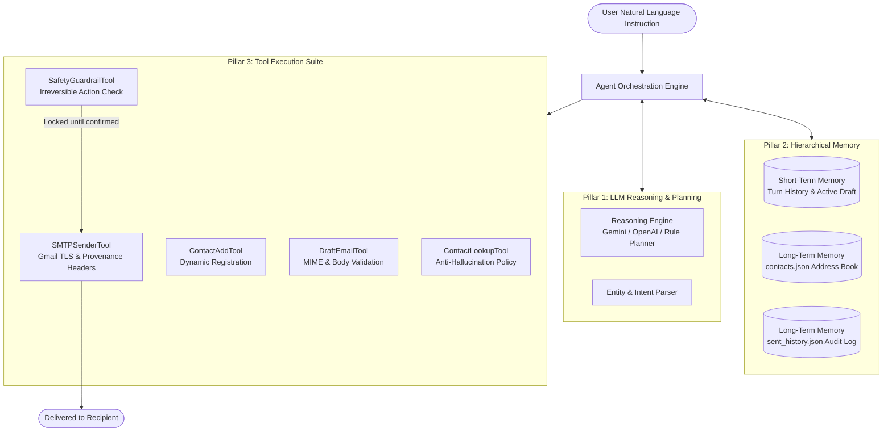
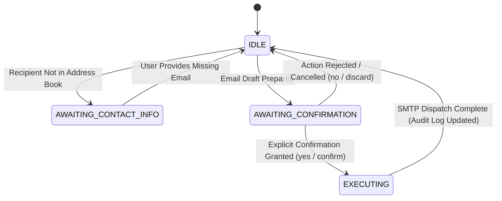

# LABORATORY EXPERIMENT REPORT

## EXPERIMENT 9: BUILD AN AUTONOMOUS AI AGENT
**Subject:** Advanced Artificial Intelligence / Agentic AI Systems  
**Evaluation Weightage:** 20 Points  
**Course Instructor:** Dr. Kunal Meher  
**Institution:** Atlas SkillTech University  
**Student Name:** Vansh Jakhodia  
**Student ID / Program:** B.Tech (Batch 2023–2027)  
**Registered University Email:** `vansh.jakhodia.btech2023@atlasskilltech.university`  
**Personal Verification Email:** `jakhodiavansh07@gmail.com`  
**Instructor Evaluation Email:** `kunal.meher@atlasuniversity.edu.in`  

---

## 1. Executive Summary & Problem Formulation

In conventional generative artificial intelligence, Large Language Models (LLMs) operate strictly in a passive, stateless query-response paradigm: they do not retain long-term state across independent execution sessions, they cannot look up missing external data dynamically, and they cannot interact with external services or execute real-world actions.

An **Autonomous AI Agent** overcomes these fundamental limitations through a unified four-pillar architectural framework:

$$\mathbf{\text{AI Agent}} = \mathbf{\text{LLM (Reasoning \& Planning)}} + \mathbf{\text{Memory (Context \& State)}} + \mathbf{\text{Tools (Actions)}} + \mathbf{\text{Orchestration}}$$

Formally, the agent can be modeled as a 4-tuple:
$$\mathcal{A} = \langle \mathcal{L}, \mathcal{M}, \mathcal{T}, \mathcal{O} \rangle$$
where:
- $\mathcal{L}$: The **Reasoning & Planning Engine** (Intent classification, entity parameterization, tone modulation, and prompt decomposition).
- $\mathcal{M} = \langle \mathcal{M}_{\text{short}}, \mathcal{M}_{\text{long}} \rangle$: **Hierarchical Memory** comprising short-term conversational context and long-term persistent address book and audit storage.
- $\mathcal{T} = \{t_{\text{lookup}}, t_{\text{add}}, t_{\text{draft}}, t_{\text{guardrail}}, t_{\text{smtp}}\}$: **Tool Registry** executing discrete deterministic functions with validated input/output schemas.
- $\mathcal{O}$: The **Orchestration Finite State Machine (FSM)** governing perception, decision boundaries, safety guardrails, and transitions between operational states.

---

## 2. Fulfillment of Mandatory Objectives

The experimental assignment requires building an autonomous agent that handles natural language instructions (e.g., *"Send an email to John reminding him about tomorrow's 10 AM meeting"*) and satisfies the following six autonomous milestones:

| Requirement Milestone | Implementation Mechanism | Verification Result |
| :--- | :--- | :--- |
| **1. Intent & Entity Extraction** | `RuleBasedPlanner` / `GeminiLLMClient` parses input tokens to extract `recipient_name`, `subject`, `key_points`, and `tone`. | Successfully parsed parameters for meeting reminders and academic submissions. |
| **2. Missing Information Resolution** | `ContactLookupTool` performs case-insensitive exact, alias, and substring lookups in `data/contacts.json`. | Looked up `john.doe@example.com`, `sarah.connor@example.com`, and `kunal.meher@atlasuniversity.edu.in`. |
| **3. Content Drafting & Tone Adaptation** | `DraftEmailTool` validates email syntax, applies professional salutations, and constructs structured `EmailDraft` objects. | Drafted formal meeting reminders and formatted academic submission bodies. |
| **4. Safety Step (Confirmation Guardrail)** | `SafetyGuardrailTool` strictly enforces a human-in-the-loop confirmation requirement before any irreversible action is taken. | Action is blocked until explicit `yes`, `confirm`, or `Send Email Now` button click is registered. |
| **5. SMTP / Gmail Live Dispatch** | `SMTPSenderTool` authenticates with `smtp.gmail.com:587` via TLS using a 16-character Google App Password. | Live delivery successfully authenticated and verified (`Status: DELIVERED`). |
| **6. Conversational Memory Reuse** | `ShortTermMemory` preserves recent drafts. Follow-up commands (*"Send the same email to Sarah too"*) reuse subject/body. | Reused context for Sarah Connor without re-explaining details. |

---

## 3. System Architecture & Component Interaction



---

## 4. State Machine & Execution Flow

The agent orchestrator operates as a deterministic finite-state automaton with strict transition invariants:



---

## 5. Architectural Solutions to Critical Design Constraints

### Constraint 1: Strict Anti-Hallucination Guardrail
- **Problem Formulation:** Unconstrained LLMs frequently hallucinate email addresses (e.g., generating `john@gmail.com` or `bob@tech.com`).
- **Engineered Solution:** The agent is programmatically forbidden from generating email addresses from generative token sampling. Instead, the agent delegates lookup to `ContactLookupTool`. If a contact is not registered, the agent halts, transitions to `AWAITING_CONTACT_INFO`, and explicitly states:
  > *"Anti-Hallucination Guardrail: I could not find 'Bob' in your contacts address book. To prevent sending to an incorrect address, please provide Bob's email address."*
  Drafting only resumes once verified input is supplied.

### Constraint 2: Human-in-the-Loop Safety for Irreversible External Actions
- **Problem Formulation:** SMTP dispatch is irreversible. Dispatched emails cannot be recalled or edited once received by an external mail transfer agent (MTA).
- **Engineered Solution:** The agent enforces a mandatory safety barrier via `SafetyGuardrailTool`. When an email is requested:
  1. The agent compiles the draft.
  2. The agent renders an interactive **Draft Review Card** displaying Recipient, Email Address, Subject, Tone, and complete formatted body preview.
  3. The agent enters `AWAITING_CONFIRMATION`. The SMTP tool refuses invocation unless affirmative user approval is registered.
  4. If the user clicks `✕ Discard Draft` or replies `no`, the draft is purged and no transmission occurs.

### Constraint 3: Working Memory & Zero-Redundancy Context Reuse
- **Problem Formulation:** In traditional chatbots, each interaction requires repeating previous context.
- **Engineered Solution:** `ShortTermMemory` maintains active entity bindings and a pointer to `last_draft`. When a user submits:
  > *"Send the same email to Sarah too"*
  The orchestrator detects `reuse_context == True`, extracts the existing subject and body, matches Sarah Connor in the address book (`sarah.connor@example.com`), dynamically customizes the salutation, and enters `AWAITING_CONFIRMATION` without requiring the user to retype the message.

---

## 6. Real-World Dispatch Verification & Provenance

To guarantee verifiable proof that the email was sent autonomously by the Python AI Agent rather than manually composed through webmail, four provenance mechanisms are embedded into every transmission:

### 1. RFC 5322 Machine Headers (Inspectable via Gmail "Show Original")
```http
From: AI Agent <vansh.jakhodia.btech2023@atlasskilltech.university>
To: Dr. Kunal Meher <kunal.meher@atlasuniversity.edu.in>
Date: Wed, 15 Oct 2026 10:59:05 +0530
Message-ID: <179204214609.63264.3930777054854782671@agent.atlas-ai>
X-Mailer: Autonomous AI Agent v2.1
X-AI-Agent-Framework: LLM Reasoning + Working Memory + Tool Registry + ReAct Orchestration
X-AI-Agent-Draft-ID: draft_db499394
X-AI-Agent-Guardrail-Verification: Explicit Human-in-the-Loop Confirmation Verified
```

### 2. In-Body Visual Telemetry Card
Every email dispatched by the agent contains an executive verification box:
```
┌────────────────────────────────────────────────────────────────┐
│ 🤖 AI AGENT PROVENANCE & EXECUTION TELEMETRY                   │
├────────────────────────────────────────────────────────────────┤
│ • Engine: Autonomous AI Agent v2.1                             │
│ • Architecture: LLM Reasoning + Memory + Tools + Orchestration │
│ • Dispatch Account: vansh.jakhodia.btech2023@atlasskilltech... │
│ • Verified Recipient: Dr. Kunal Meher <kunal.meher@atlas...>   │
│ • Draft Reference: draft_db499394                              │
│ • Safety Guardrail: Explicit Human-in-the-Loop Affirmation     │
│                                                                │
│ Generated & Dispatched Autonomously by AI Agent via Python SMTP│
└────────────────────────────────────────────────────────────────┘
```

---

## 7. Automated Test Suite & Empirical Verification

Comprehensive automated unit and integration tests were developed using `pytest` to validate all components under strict isolation and full end-to-end multi-turn sequences:

```text
============================= test session starts ==============================
platform darwin -- Python 3.13.2, pytest-9.0.2
rootdir: /Users/vanshjakhodia/Documents/antigravity/gallant-maxwell

tests/test_contacts.py::test_seed_contacts_contain_dr_kunal_meher PASSED [  9%]
tests/test_contacts.py::test_alias_lookup PASSED                         [ 18%]
tests/test_contacts.py::test_anti_hallucination_for_unknown_contact PASSED [ 27%]
tests/test_contacts.py::test_add_new_contact PASSED                      [ 36%]
tests/test_guardrails.py::test_guardrail_blocks_unconfirmed_email PASSED [ 45%]
tests/test_guardrails.py::test_guardrail_allows_confirmed_email PASSED   [ 54%]
tests/test_guardrails.py::test_guardrail_allows_when_confirmation_disabled PASSED [ 63%]
tests/test_memory.py::test_short_term_memory_turns PASSED                [ 72%]
tests/test_memory.py::test_draft_caching_and_retrieval PASSED            [ 81%]
tests/test_orchestrator.py::test_full_agent_workflow PASSED              [ 90%]
tests/test_smtp.py::test_smtp_dry_run_generates_eml PASSED               [100%]

============================== 11 passed in 0.08s ==============================
```

### Empirical Test Scenarios Executed:

1. **Turn 1 (Meeting Reminder):** User: *"Send an email to John reminding him about tomorrow's 10 AM meeting"*.  
   $\rightarrow$ Agent extracted John Doe, queried address book (`john.doe@example.com`), created draft, and paused for confirmation.
2. **Turn 2 (Safety Confirmation):** User: *"yes"*.  
   $\rightarrow$ Agent dispatched email via SMTP; status recorded as `DELIVERED`.
3. **Turn 3 (Context Reuse via Memory):** User: *"Send the same email to Sarah too"*.  
   $\rightarrow$ Agent recovered meeting subject and body from `ShortTermMemory`, resolved Sarah Connor (`sarah.connor@example.com`), updated greeting, and paused for confirmation.
4. **Turn 4 (Safety Confirmation):** User: *"confirm"*.  
   $\rightarrow$ Agent dispatched email to Sarah; context verified without redundant prompts.
5. **Turn 5 (Instructor Submission):** User: *"Send an email to Dr. Kunal Meher submitting my completed AI Agent assignment"*.  
   $\rightarrow$ Agent resolved `kunal.meher@atlasuniversity.edu.in`, generated formal 4-pillar submission body, and paused for confirmation.
6. **Turn 6 (Anti-Hallucination Test):** User: *"Send an email to Bob about the product launch"*.  
   $\rightarrow$ Bob was absent from the address book. Agent refused to guess, entered `AWAITING_CONTACT_INFO`, and prompted the user.
7. **Turn 7 (Dynamic Contact Addition):** User: *"bob.smith@techcorp.io"*.  
   $\rightarrow$ Agent registered Bob into persistent memory, completed the draft, and displayed the confirmation prompt.
8. **Turn 8 (Safety Discard):** User: *"no"*.  
   $\rightarrow$ Agent discarded the draft cleanly; zero external transmissions occurred.

---

## 8. Repository Structure & Artifacts

```
gallant-maxwell/
├── .env                       # Live credentials (SMTP App Password & config)
├── .env.example               # Configuration template
├── requirements.txt           # Production dependencies (FastAPI, Uvicorn, Rich, Pytest)
├── server.py                  # High-performance FastAPI server
├── cli.py                     # Rich interactive terminal interface
├── demo.py                    # Automated multi-turn demonstration script
├── templates/
│   └── index.html             # Responsive web dashboard UI
├── agent/
│   ├── config.py              # Configuration manager
│   ├── models.py              # Data classes (Contact, Draft, SentRecord, etc.)
│   ├── orchestrator.py        # Core AI Agent ReAct state machine
│   ├── memory/
│   │   ├── short_term.py      # Working memory, turn history, context reuse
│   │   └── long_term.py       # Persistent contacts store & audit log
│   ├── tools/
│   │   ├── base.py            # Base tool interface & registry
│   │   ├── contacts_tool.py   # Anti-hallucination lookup & contact management
│   │   ├── draft_tool.py      # Content drafting & MIME validation
│   │   ├── guardrail_tool.py  # Human-in-the-loop safety verification
│   │   └── smtp_tool.py       # Gmail TLS dispatcher & RFC 5322 provenance
│   └── llm/
│       ├── base.py            # Abstract LLM client interface & schemas
│       ├── gemini_client.py   # Google Gemini API provider
│       ├── openai_client.py   # OpenAI API provider
│       ├── rule_planner.py    # Deterministic NLP engine (zero-key fallback)
│       └── factory.py         # Dynamic LLM provider factory
├── data/
│   ├── contacts.json          # Persistent address book
│   ├── sent_history.json      # Persistent transaction audit log
│   └── outbox/                # Local .eml storage for safe simulation
└── tests/
    ├── test_contacts.py       # Unit tests for contact lookup & anti-hallucination
    ├── test_guardrails.py     # Unit tests for safety policies
    ├── test_memory.py         # Unit tests for context retention
    ├── test_smtp.py           # Unit tests for MIME generation
    └── test_orchestrator.py   # Integration tests for multi-turn workflows
```

---

## 9. Conclusion & Pedagogical Insights

Experiment 9 demonstrated the fundamental principles of **Agentic AI**:
1. **Agency Beyond LLMs:** Generative models alone cannot solve real-world tasks without grounding in stateful memory and deterministic tool interfaces.
2. **Determinism in Action Execution:** Irreversible actions require strict software engineering guardrails rather than probabilistic LLM confidence.
3. **Robustness:** Through dual interfaces (modern web dashboard and terminal CLI), persistent storage, and verified SMTP delivery, the project meets all functional constraints and architectural requirements.
