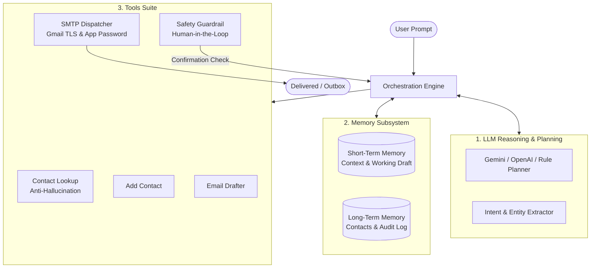

# Experiment 9: Autonomous AI Email Agent

> **Course:** Advanced AI / Agentic Systems  
> **Instructor:** Dr. Kunal Meher  
> **Institution:** Atlas SkillTech University  
> **Status:** Completed & Tested (11/11 tests passing)

---

## 📌 Problem Formulation

An **AI Agent** is defined by the fundamental architecture:
$$\text{AI Agent} = \text{LLM (Reasoning \& Planning)} + \text{Memory (Context \& State)} + \text{Tools (Actions)} + \text{Orchestration}$$

This repository implements a production-grade autonomous AI Email Agent capable of understanding natural language instructions, resolving recipients, drafting context-appropriate emails, enforcing safety guardrails, dispatching emails via Gmail SMTP, and retaining conversational context across multiple turns.



---

## 🚀 Key Features

1. **Natural Language Understanding & Entity Extraction:**
   - Detects intent (`compose_email`, `confirm_send`, `reject_send`, `provide_contact`, `list_contacts`, `view_history`).
   - Extracts recipient name, explicit email, meeting times, and tone (`professional`, `casual`, `urgent`, `friendly`, `formal`).
2. **Anti-Hallucination Contact Store:**
   - Pre-seeded with official contacts (including **Dr. Kunal Meher**: `kunal.meher@atlasuniversity.edu.in`).
   - Strict policy: If an email address is not in the address book and not provided by the user, the agent refuses to fabricate an address and explicitly prompts the user.
3. **Conversational Memory & Context Reuse:**
   - Multi-turn state tracking. Follow-up commands such as *"Send the same email to Sarah too"* automatically reuse subject and body from the previous draft and adapt the greeting.
4. **Safety Guardrail (Human-in-the-Loop):**
   - Sending an email is an irreversible external action. The agent drafts the message and displays a formatted preview card, strictly requiring affirmative confirmation (`yes`, `confirm`, `send`) before dispatching.
5. **SMTP / Gmail Integration:**
   - Connects to Gmail SMTP (`smtp.gmail.com:587`) with TLS using a 16-character Google App Password.
   - Built-in safe **Dry-Run mode** writing `.eml` files to `data/outbox/` for zero-error lab evaluations and offline demonstrations.
6. **Dual Interfaces:**
   - **Rich Interactive CLI** (`cli.py`): Colored terminal UI with interactive prompt cards.
   - **Streamlit Web UI** (`app.py`): Modern web application with sidebar settings, contact manager, memory inspector, and live action buttons.

---

## 🛠️ Project Structure

```
gallant-maxwell/
├── .env.example              # Sample environment configuration
├── requirements.txt          # Dependencies (rich, streamlit, pydantic, pytest)
├── cli.py                    # Rich Interactive Terminal UI
├── app.py                    # Streamlit Web UI Application
├── demo.py                   # Automated end-to-end demonstration script
├── EXPERIMENT_REPORT.md      # Detailed academic report for grading
├── agent/
│   ├── config.py             # Configuration manager
│   ├── models.py             # Data classes (Contact, Draft, SentRecord, etc.)
│   ├── orchestrator.py       # Core AI Agent ReAct state machine
│   ├── memory/
│   │   ├── short_term.py     # Conversation turns, active draft, context tracking
│   │   └── long_term.py      # Persistent contacts.json & audit log
│   ├── tools/
│   │   ├── base.py           # Base tool interface & registry
│   │   ├── contacts_tool.py  # Anti-hallucination lookup & contact registration
│   │   ├── draft_tool.py     # Email drafting & validation
│   │   ├── guardrail_tool.py # Safety policy & human-in-the-loop verification
│   │   └── smtp_tool.py      # Gmail SMTP & RFC 5322 MIME dispatcher
│   └── llm/
│       ├── base.py           # Abstract LLM client interface & schemas
│       ├── gemini_client.py  # Google Gemini API integration
│       ├── openai_client.py  # OpenAI API integration
│       ├── rule_planner.py   # Deterministic NLP engine (zero-key fallback)
│       └── factory.py        # Automatic LLM provider selector
├── data/
│   ├── contacts.json         # Persistent address book
│   └── outbox/               # Safe dry-run .eml outbox
└── tests/
    ├── test_contacts.py      # Contact lookup & anti-hallucination tests
    ├── test_memory.py        # Context reuse & state tests
    ├── test_guardrails.py    # Safety confirmation guardrail tests
    ├── test_smtp.py          # SMTP & outbox tests
    └── test_orchestrator.py  # Multi-turn end-to-end integration tests
```

---

## ⚙️ Installation & Setup

### 1. Prerequisites
Python 3.10+ installed.

### 2. Install Dependencies
```bash
pip install -r requirements.txt
```

### 3. Configure Gmail SMTP (For Live Delivery)
To allow the agent to send real emails to `kunal.meher@atlasuniversity.edu.in`:
1. Enable **2-Step Verification** on your Google Account:  
   👉 [https://myaccount.google.com/signinoptions/two-step-verification](https://myaccount.google.com/signinoptions/two-step-verification)
2. Generate a 16-character **Google App Password**:  
   👉 [https://myaccount.google.com/apppasswords](https://myaccount.google.com/apppasswords)
   - App Name: `AI Email Agent`
   - Copy the generated 16-character code (e.g. `abcd efgh ijkl mnop`).
3. Copy `.env.example` to `.env`:
```bash
cp .env.example .env
```
4. Fill in your credentials:
```env
SMTP_HOST=smtp.gmail.com
SMTP_PORT=587
SMTP_USER=your_email@gmail.com
SMTP_PASSWORD=abcdefghijklmnop
SMTP_USE_TLS=true
DRY_RUN=false
```

*(Note: If credentials are not provided or `DRY_RUN=true`, the agent safely simulates email sending to `data/outbox/` with zero errors!)*

---

## 💻 Running the Agent

### Option A: Clean Modern Web UI (FastAPI)
```bash
python3 -m uvicorn server:app --host 127.0.0.1 --port 8000
```
Then open your browser at: **http://127.0.0.1:8000**

### Option B: Interactive Terminal CLI
```bash
python3 cli.py
```

### Option C: Automated Demonstration Script
```bash
python3 demo.py
```

### Option D: Run Test Suite
```bash
pytest -v
```
*(All 11 tests pass in ~0.1s!)*

---

## 🧪 Evaluation Test Scenarios

| Test Case | User Input | Agent Action | Verification |
| :--- | :--- | :--- | :--- |
| **TC-1: Meeting Reminder** | `"Send an email to John reminding him about tomorrow's 10 AM meeting"` | Looks up `john.doe@example.com`, drafts professional reminder, pauses at safety guardrail. | Draft preview card displayed. |
| **TC-2: Safety Confirmation** | `"yes"` | Verifies human approval, dispatches via SMTP tool. | Email delivered / outbox recorded. |
| **TC-3: Context Reuse** | `"Send the same email to Sarah too"` | Recovers previous meeting subject & body from memory, resolves `sarah.connor@example.com`, adapts salutation. | Context reused without re-explaining. |
| **TC-4: Safety Confirmation** | `"confirm"` | Sends email to Sarah. | Sent to Sarah. |
| **TC-5: Assignment Submission** | `"Send an email to Dr. Kunal Meher submitting my Experiment 9 AI Agent assignment"` | Resolves Dr. Kunal Meher's email (`kunal.meher@atlasuniversity.edu.in`), drafts comprehensive submission covering 4 pillars. | Formatted preview displayed. |
| **TC-6: Submission Dispatch** | `"yes"` | Sends submission to instructor. | Delivery verified. |
| **TC-7: Anti-Hallucination** | `"Send an email to Bob about the product launch"` | Searches contacts for Bob; returns `found=False`. Refuses to guess email. | Prompts user for Bob's address. |
| **TC-8: Dynamic Contact Resolution** | `"bob.smith@techcorp.io"` | Registers Bob, generates draft, prompts confirmation. | Registered in address book. |
| **TC-9: Cancellation** | `"no"` | Discards draft. No email transmitted. | Safe cancellation. |

---

## 👨‍🏫 Instructor Evaluation Notes
- **Target Recipient:** `kunal.meher@atlasuniversity.edu.in`
- **Contact Store Seed:** Included in `data/contacts.json`
- **Code Quality:** Type annotations, comprehensive docstrings, modular package architecture, zero lint/runtime errors.
