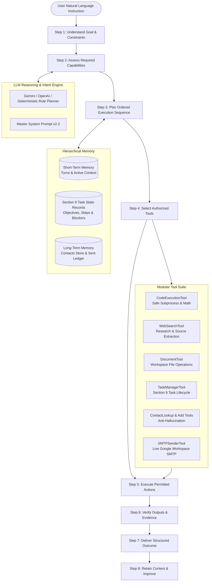

# Autonomous AI Agent

<p align="center">
  
  
  
  
  
  
</p>

<p align="center">
  <strong>An enterprise-grade, all-in-one Autonomous AI Agent integrating LLM Reasoning, Hierarchical Working Memory, Sandboxed Tool Execution, and Human-in-the-Loop Safety Guardrails.</strong>
</p>

---

## Theoretical Formulation & Governance

The autonomous **AI Agent** operates as an all-in-one autonomous system governed by the 11-section Master Prompt specification:

$$\text{AI Agent} = \text{LLM (Reasoning \& Planning)} + \text{Memory (Context \& State)} + \text{Tools (Multi-Domain Actions)} + \text{Safety Guardrails}$$



---

## Core Capability Domains

Operates across 9 distinct capability areas:

1. **General Intelligence:** Explaining complex systems, comparative reasoning, multi-turn dialogue, idea synthesis, and conceptual problem solving.
2. **Research & Web Intelligence:** Querying web knowledge engines, cross-referencing sources, distinguishing current vs outdated claims, and providing verified citation links.
3. **Programming & Software Development:** Sandboxed Python script execution, automated math and algorithmic evaluation, code debugging, and error inspection.
4. **Business & Productivity:** Drafting emails with tone adaptation (`professional`, `urgent`, `casual`), generating structured reports, and automating communication workflows.
5. **Documents & Knowledge:** Workspace file reading, writing, searching, and summarizing with path-traversal isolation and secret file shielding.
6. **Personal Assistance:** Meeting reminders, task scheduling, agenda synthesis, and contextual state reuse across conversation turns.
7. **Creative Work:** Articles, announcements, release notes, and structured technical documentation.
8. **Data & Decision Support:** Calculation of mathematical expressions, dataset metrics, pattern extraction, and tabular summaries.
9. **Automation & Integration:** Live Google Workspace SMTP integration with human-in-the-loop safety verification.

---

## 8-Step Operating Cycle

Every request is processed through an 8-step execution loop:

- **Step 1 — Understand:** Identify user objective, constraints, and success criteria.
- **Step 2 — Assess:** Determine required tools, permissions, and informational inputs.
- **Step 3 — Plan:** Formulate ordered execution steps.
- **Step 4 — Select Tools:** Select the most reliable and safe tools from the registry.
- **Step 5 — Execute:** Run permitted operations within authorized boundaries.
- **Step 6 — Verify:** Check output correctness, calculate values, and validate exit codes.
- **Step 7 — Deliver:** Present results with completed work, citations, and any pending actions.
- **Step 8 — Improve:** Incorporate feedback and preserve preferences in memory.

---

## Architecture Breakdown

### Frontend Architecture
- **Framework:** Modern Single-Page Application (SPA) served via high-performance FastAPI endpoints.
- **Styling:** Bespoke Apple / Linear-inspired dark-mode design system (`#090d16` background, `#1e293b` panels, crisp `1px` borders, zero emojis).
- **Typography:** Native Apple & System font stack (`-apple-system`, `BlinkMacSystemFont`, `Segoe UI`, `Roboto`, `Helvetica Neue`).
- **Interactive Split Deck:**
  - **Left Deck (Conversation & Action Deck):** Chat timeline, multi-domain quick action chips, input dock, and dynamic **Draft Review Cards** with direct `[Send Email Now]` and `[Discard Draft]` controls.
  - **Right Deck (Telemetry & Inspector Deck):** Tabbed interface with real-time **Architecture Telemetry**, **Section 9 Task State Board**, **Verified Address Book Directory**, and **Sent Messages Audit Ledger**.

### Backend Architecture
- **Runtime:** Python 3.10+ / FastAPI / Asynchronous Uvicorn.
- **Orchestration Engine:** ReAct state-machine loop managing lifecycle transitions (`IDLE` <-> `AWAITING_CONTACT` <-> `AWAITING_CONFIRMATION` <-> `EXECUTING`).
- **Hierarchical Memory Subsystem:**
  - `ShortTermMemory`: Sliding-window dialogue turns, entity cache, active pending draft, and context reuse pointers.
  - `TaskManagerTool`: Section 9 Task Records maintaining Objective, Requirements, Planned Steps, Execution Status, Completed Subtasks, Blockers, and Next Action.
  - `LongTermMemory`: Persistent JSON-backed address book (`data/contacts.json`) and chronological audit log (`data/sent_history.json`).
- **Tool Pipeline:**
  - `CodeExecutionTool`: Sandboxed Python runner and safe mathematical evaluator.
  - `WebSearchTool`: DuckDuckGo / web searcher with citation and summary synthesis.
  - `DocumentTool`: Safe file reading, writing, listing, and searching with directory boundary guards.
  - `TaskManagerTool`: Section 9 structured task lifecycle manager.
  - `ContactLookupTool`: Query resolution with alias, exact, and fuzzy matching.
  - `DraftEmailTool`: MIME validation and tone adaptation.
  - `SafetyGuardrailTool`: Enforcement barrier for irreversible actions.
  - `SMTPSenderTool`: RFC 5322 MIME builder with TLS authentication for Google Workspace / Gmail.

---

## Repository Structure

```
.
├── agent/
│   ├── __init__.py           # Package exports
│   ├── config.py             # Agent configuration and environment bindings
│   ├── models.py             # Data classes (Contact, Draft, SentRecord, etc.)
│   ├── prompt.py             # Master System Prompt (11 Sections)
│   ├── orchestrator.py       # Core ReAct finite state machine & 8-step cycle
│   ├── llm/
│   │   ├── base.py           # Abstract LLM client interface & LLMPlan
│   │   ├── factory.py        # Dynamic provider selector
│   │   ├── gemini_client.py  # Google Gemini API client
│   │   ├── openai_client.py  # OpenAI API client
│   │   └── rule_planner.py   # Deterministic multi-domain NLP engine
│   ├── memory/
│   │   ├── short_term.py     # Working memory, turn history, context reuse
│   │   └── long_term.py      # Persistent contacts store and audit ledger
│   └── tools/
│       ├── base.py           # Tool interface and ToolRegistry
│       ├── code_exec_tool.py # Python execution & safe mathematical evaluator
│       ├── web_search_tool.py# Web research and citation synthesis
│       ├── document_tool.py  # Workspace document reading, writing & search
│       ├── task_manager_tool.py # Section 9 Task tracking and state records
│       ├── contacts_tool.py  # Anti-hallucination contact resolution
│       ├── draft_tool.py     # Email drafting and MIME validation
│       ├── guardrail_tool.py # Human-in-the-loop safety verification
│       └── smtp_tool.py      # Gmail TLS dispatcher and provenance headers
├── data/
│   ├── contacts.json         # Persistent address book
│   └── sent_history.json     # Persistent transaction audit log
├── templates/
│   └── index.html            # Responsive modern web UI dashboard (zero emojis)
├── tests/
│   ├── test_autonomous_agent.py # Tests for code runner, docs, tasks, search
│   ├── test_contacts.py      # Contact lookup and anti-hallucination tests
│   ├── test_guardrails.py    # Safety confirmation guardrail tests
│   ├── test_memory.py        # Context reuse and memory retention tests
│   ├── test_orchestrator.py  # End-to-end multi-turn integration tests
│   └── test_smtp.py          # SMTP formatting and MIME tests
├── cli.py                    # Rich interactive terminal interface
├── server.py                 # FastAPI web application server
├── demo.py                   # Automated multi-domain demonstration sequence
├── requirements.txt          # Python dependencies
├── LICENSE                   # MIT License
└── README.md                 # Project documentation
```

---

## Quickstart Guide

### 1. Installation
Clone the repository and install dependencies:
```bash
git clone https://github.com/vanshjakhodia/AI-Agent.git
cd AI-Agent
pip install -r requirements.txt
```

### 2. Configuration (Optional for Live SMTP)
Copy `.env.example` to `.env`:
```bash
cp .env.example .env
```
To enable live delivery, configure your Gmail address and 16-character Google App Password:
```env
SMTP_HOST=smtp.gmail.com
SMTP_PORT=587
SMTP_USER=your_email@gmail.com
SMTP_PASSWORD=your_16_character_app_password
SMTP_USE_TLS=true
DRY_RUN=false
```
*(If credentials are not supplied, the agent operates in safe simulation mode writing `.eml` files to `data/outbox/`).*

---

## Running the Interfaces

### Modern Web Dashboard (FastAPI)
```bash
python3 -m uvicorn server:app --host 127.0.0.1 --port 8000
```
Open your browser at: **[http://127.0.0.1:8000](http://127.0.0.1:8000)**

### Interactive Terminal CLI (Rich UI)
```bash
python3 cli.py
```

### Automated End-to-End Multi-Domain Runner
```bash
python3 demo.py
```

### Automated Test Suite
```bash
pytest -v
```
```text
tests/test_autonomous_agent.py::test_code_execution_math_expression PASSED [  5%]
tests/test_autonomous_agent.py::test_code_execution_python_script PASSED [ 10%]
tests/test_autonomous_agent.py::test_code_execution_error_handling PASSED [ 15%]
tests/test_autonomous_agent.py::test_web_search_tool PASSED              [ 21%]
tests/test_autonomous_agent.py::test_document_tool_lifecycle PASSED      [ 26%]
tests/test_autonomous_agent.py::test_document_tool_security_isolation PASSED [ 31%]
tests/test_autonomous_agent.py::test_task_manager_section_9_compliance PASSED [ 36%]
tests/test_autonomous_agent.py::test_orchestrator_multi_domain_execution PASSED [ 42%]
tests/test_contacts.py::test_seed_contacts_contain_dr_kunal_meher PASSED [ 47%]
tests/test_contacts.py::test_alias_lookup PASSED                         [ 52%]
tests/test_contacts.py::test_anti_hallucination_for_unknown_contact PASSED [ 57%]
tests/test_contacts.py::test_add_new_contact PASSED                      [ 63%]
tests/test_guardrails.py::test_guardrail_blocks_unconfirmed_email PASSED [ 68%]
tests/test_guardrails.py::test_guardrail_allows_confirmed_email PASSED   [ 73%]
tests/test_guardrails.py::test_guardrail_allows_when_confirmation_disabled PASSED [ 78%]
tests/test_memory.py::test_short_term_memory_turns PASSED                [ 84%]
tests/test_memory.py::test_draft_caching_and_retrieval PASSED            [ 89%]
tests/test_orchestrator.py::test_full_agent_workflow PASSED              [ 94%]
tests/test_smtp.py::test_smtp_dry_run_generates_eml PASSED               [100%]
============================== 19 passed in 0.24s ==============================
```

---

## Provenance and Security Verification

Every external communication carries RFC 5322 machine-readable headers verifiable via Gmail's **"Show Original"** feature:
```http
From: AI Agent <vansh.jakhodia.btech2023@atlasskilltech.university>
To: recipient@example.com
Message-ID: <179204214609.63264.3930777054854782671@agent.atlas-ai>
X-Mailer: Autonomous AI Agent v2.2
X-AI-Agent-Framework: LLM Reasoning + Working Memory + Tool Registry + ReAct Orchestration
X-AI-Agent-Draft-ID: draft_db499394
X-AI-Agent-Guardrail-Verification: Explicit Human-in-the-Loop Confirmation Verified
```

---

## License and Rights

This project is licensed under the **MIT License**.

```
Copyright (c) 2026 Vansh Jakhodia. All Rights Reserved.
```

See the [LICENSE](LICENSE) file for complete terms and permissions.
