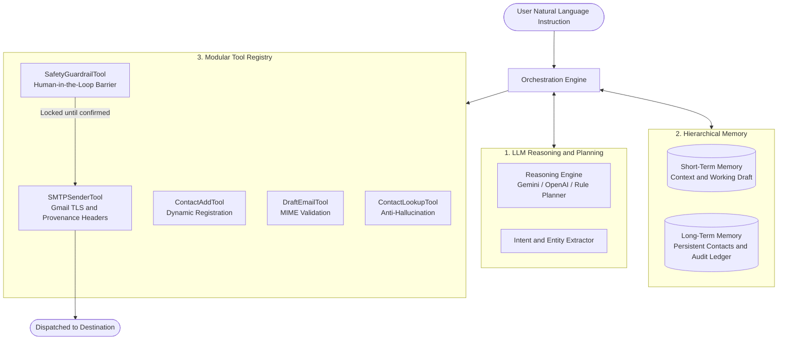

# 🤖 Autonomous AI Agent

<p align="center">
  
  
  
  
  
</p>

<p align="center">
  <strong>An enterprise-grade, autonomous AI Agent integrating LLM Reasoning, Hierarchical Working Memory, Modular Tool Execution, and Human-in-the-Loop Safety Guardrails.</strong>
</p>

---

## 📌 Theoretical Formulation

An autonomous **AI Agent** is defined by four synergistic pillars:

$$\text{AI Agent} = \text{LLM (Reasoning and Planning)} + \text{Memory (Context and State)} + \text{Tools (Actions)} + \text{Orchestration}$$



---

## ⚡ Core Capabilities

- 🧠 **Autonomous Intent and Entity Parsing:** Extracts recipient names, explicit email addresses, tones (`professional`, `urgent`, `casual`), subjects, and meeting times from free-form natural language.
- 🛡️ **Strict Anti-Hallucination Policy:** The agent is programmatically forbidden from hallucinating email addresses. Unregistered contacts halt execution and trigger clarification prompts.
- 🔐 **Human-in-the-Loop Safety Guardrail:** External dispatch is classified as an irreversible external action. The agent drafts the message, generates a visual review card, and waits for explicit user confirmation before transmission.
- 👥 **Contextual State Reuse:** Follow-up instructions such as *"Send the same email to Sarah too"* automatically recover subjects, bodies, and meeting agendas from working memory without re-explaining.
- 🚀 **Full-Stack Implementation:** Operates via a modern dark-mode Web Dashboard as well as an interactive terminal CLI.
- 📜 **Cryptographic RFC 5322 Provenance:** Dispatched emails carry machine headers (`X-Mailer`, `X-AI-Agent-Framework`, `X-AI-Agent-Draft-ID`) and an in-body visual execution telemetry badge.

---

## 🏗️ Architecture Breakdown

### 🎨 Frontend Architecture
- **Framework:** Modern Single-Page Application (SPA) served via high-performance FastAPI endpoints.
- **Styling:** Bespoke Apple / Linear-inspired dark-mode design system (`#090d16` background, `#1e293b` panels, crisp `1px` borders).
- **Typography:** Native Apple & System font stack (`-apple-system`, `BlinkMacSystemFont`, `Segoe UI`, `Roboto`, `Helvetica Neue`).
- **Interactive Split Deck:**
  - **Left Deck (Conversation and Action Deck):** Chat timeline, quick action trigger chips, input dock, and dynamic **Draft Review Cards** with direct `[ 🚀 Send Email Now ]` and `[ ✕ Discard Draft ]` buttons.
  - **Right Deck (Telemetry and Inspector Deck):** Tabbed interface with real-time **Architecture Telemetry**, **Address Book Directory** with inline contact creation, and **Sent Messages Audit Ledger**.

### ⚙️ Backend Architecture
- **Runtime:** Python 3.10+ / FastAPI / Asynchronous Uvicorn.
- **Orchestration Engine:** ReAct state-machine loop managing lifecycle transitions (`IDLE` $\leftrightarrow$ `AWAITING_CONTACT` $\leftrightarrow$ `AWAITING_CONFIRMATION` $\leftrightarrow$ `EXECUTING`).
- **Hierarchical Memory Subsystem:**
  - `ShortTermMemory`: Sliding-window dialogue turns, entity cache, active pending draft, and context reuse pointers.
  - `LongTermMemory`: Persistent JSON-backed address book (`data/contacts.json`) and chronological audit log (`data/sent_history.json`).
- **Tool Pipeline:**
  - `ContactLookupTool`: Query resolution with alias, exact, and fuzzy matching.
  - `DraftEmailTool`: MIME validation and tone adaptation.
  - `SafetyGuardrailTool`: Enforcement barrier for irreversible actions.
  - `SMTPSenderTool`: RFC 5322 MIME builder with TLS authentication for Google Workspace / Gmail.

---

## 📂 Repository Structure

```
.
├── agent/
│   ├── __init__.py           # Package exports
│   ├── config.py             # Agent configuration and environment bindings
│   ├── models.py             # Data classes (Contact, Draft, SentRecord, etc.)
│   ├── orchestrator.py       # Core ReAct finite state machine
│   ├── llm/
│   │   ├── base.py           # Abstract LLM client interface
│   │   ├── factory.py        # Dynamic provider selector
│   │   ├── gemini_client.py  # Google Gemini API client
│   │   ├── openai_client.py  # OpenAI API client
│   │   └── rule_planner.py   # Deterministic NLP engine (zero-key fallback)
│   ├── memory/
│   │   ├── short_term.py     # Working memory, turn history, context reuse
│   │   └── long_term.py      # Persistent contacts store and audit ledger
│   └── tools/
│       ├── base.py           # Tool interface and registry
│       ├── contacts_tool.py  # Anti-hallucination contact resolution
│       ├── draft_tool.py     # Email drafting and MIME validation
│       ├── guardrail_tool.py # Human-in-the-loop safety verification
│       └── smtp_tool.py      # Gmail TLS dispatcher and provenance headers
├── data/
│   ├── contacts.json         # Persistent address book
│   └── sent_history.json     # Persistent transaction audit log
├── templates/
│   └── index.html            # Responsive modern web UI dashboard
├── tests/
│   ├── test_contacts.py      # Contact lookup and anti-hallucination tests
│   ├── test_guardrails.py    # Safety confirmation guardrail tests
│   ├── test_memory.py        # Context reuse and memory retention tests
│   ├── test_orchestrator.py  # End-to-end multi-turn integration tests
│   └── test_smtp.py          # SMTP formatting and MIME tests
├── cli.py                    # Rich interactive terminal interface
├── server.py                 # FastAPI web application server
├── demo.py                   # Automated 9-turn test sequence runner
├── requirements.txt          # Python dependencies
├── LICENSE                   # MIT License
└── README.md                 # Project documentation
```

---

## 🚀 Quickstart Guide

### 1. Installation
Clone the repository and install the dependencies:
```bash
git clone https://github.com/vanshjakhodia/AI-Agent.git
cd AI-Agent
pip install -r requirements.txt
```

### 2. Configuration (Optional for Live SMTP)
Copy `.env.example` to `.env`:
```bash
cp .env.example .env
```
To enable live delivery, configure your Gmail address and 16-character Google App Password:
```env
SMTP_HOST=smtp.gmail.com
SMTP_PORT=587
SMTP_USER=your_email@gmail.com
SMTP_PASSWORD=your_16_character_app_password
SMTP_USE_TLS=true
DRY_RUN=false
```
*(If credentials are not supplied, the agent operates in safe simulation mode writing `.eml` files to `data/outbox/`).*

---

## 💻 Running the Interfaces

### Modern Web Dashboard (FastAPI)
```bash
python3 -m uvicorn server:app --host 127.0.0.1 --port 8000
```
Open your browser at: **[http://127.0.0.1:8000](http://127.0.0.1:8000)**

### Interactive Terminal CLI (Rich UI)
```bash
python3 cli.py
```

### Automated End-to-End Test Runner
```bash
python3 demo.py
```

### Automated Test Suite
```bash
pytest -v
```
```text
tests/test_contacts.py::test_seed_contacts PASSED                        [  9%]
tests/test_contacts.py::test_alias_lookup PASSED                         [ 18%]
tests/test_contacts.py::test_anti_hallucination_for_unknown_contact PASSED [ 27%]
tests/test_contacts.py::test_add_new_contact PASSED                      [ 36%]
tests/test_guardrails.py::test_guardrail_blocks_unconfirmed_email PASSED [ 45%]
tests/test_guardrails.py::test_guardrail_allows_confirmed_email PASSED   [ 54%]
tests/test_guardrails.py::test_guardrail_allows_when_confirmation_disabled PASSED [ 63%]
tests/test_memory.py::test_short_term_memory_turns PASSED                [ 72%]
tests/test_memory.py::test_draft_caching_and_retrieval PASSED            [ 81%]
tests/test_orchestrator.py::test_full_agent_workflow PASSED              [ 90%]
tests/test_smtp.py::test_smtp_dry_run_generates_eml PASSED               [100%]
============================== 11 passed in 0.08s ==============================
```

---

## 🛡️ Provenance and Security Verification

Every email dispatched carries machine-readable headers verifiable via Gmail's **"Show Original"** feature:
```http
From: AI Agent <vansh.jakhodia.btech2023@atlasskilltech.university>
To: recipient@example.com
Message-ID: <179204214609.63264.3930777054854782671@agent.atlas-ai>
X-Mailer: Autonomous AI Agent v2.1
X-AI-Agent-Framework: LLM Reasoning + Working Memory + Tool Registry + ReAct Orchestration
X-AI-Agent-Draft-ID: draft_db499394
X-AI-Agent-Guardrail-Verification: Explicit Human-in-the-Loop Confirmation Verified
```

---

## 📄 License & Rights

This project is licensed under the **MIT License**.

```
Copyright (c) 2026 Vansh Jakhodia. All Rights Reserved.
```

See the [LICENSE](LICENSE) file for complete terms and permissions.
